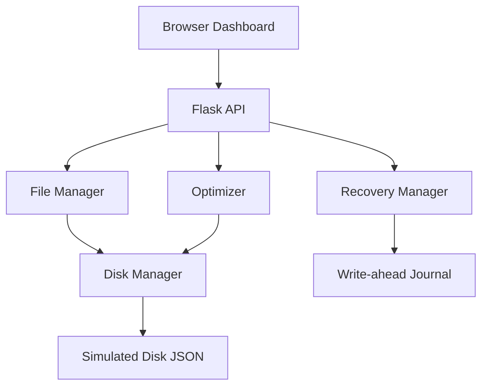

# System flow

## Data model

The simulated disk JSON contains:
- `total_blocks`: number of simulated blocks.
- `block_size`: bytes represented by one block.
- `bitmap`: zero for free and one for allocated.
- `files`: path-keyed metadata and file content.
- `directories`: known directory paths.

## Recovery sequence

A pending CREATE record is durably written to the journal before the simulated
operation is applied. The recovery action replays pending records and marks
them COMMITTED. Repeating recovery does not create duplicate files.
